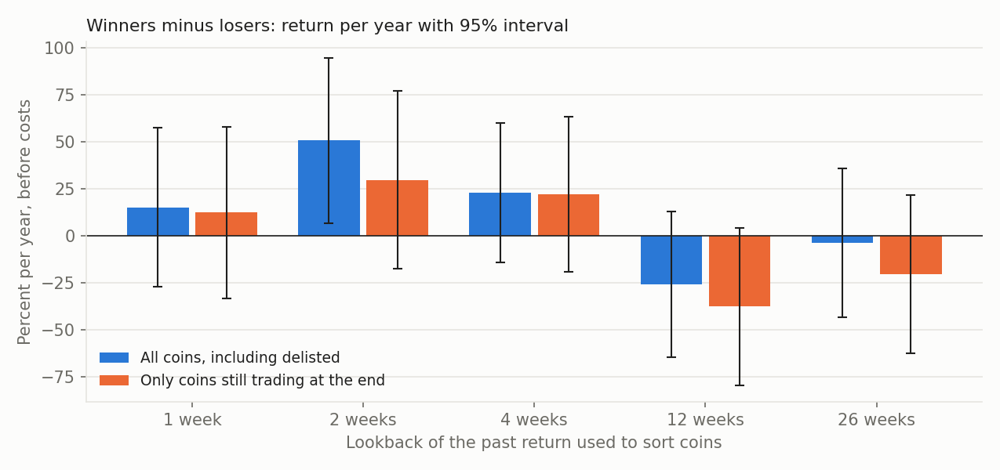

# Do crypto winners keep winning, or give it back?

[](https://github.com/rxj0102/crypto-stat-arb/actions/workflows/ci.yml)

**Question.** Two claims are common about the cross-section of crypto returns: coins that fell last week bounce back (reversal), and coins that rose over the last few months keep rising (momentum). Does either hold among liquid coins, after one day of delay, on a universe that includes the coins that later died?

<!-- headline:start (generated by scripts/render_readme.py, do not edit by hand) -->
**Answer, from 380 weekly rebalances between 2019 and 2026 on data that keeps the 200 coins that stopped trading: neither holds up.** None of the five lookbacks is significant once the five tests are counted. The best, a 2 week sort, earns 51% a year before costs with t = 2.3, and a corrected p-value of 0.12. There is no reversal at one week and no momentum at 12 or 26 weeks. What return there is at 1 to 4 weeks comes from the short side, losers that keep losing, which is the side hardest to trade. Two things a careless backtest would get wrong are large here: trading at the same close that produces the signal adds 32% a year to the 1 week sort (t = 2.8), and dropping coins that later died adds 9% a year to the average coin (t = 2.5).
<!-- headline:end -->

Every number on this page is written by `scripts/reproduce.py`, and CI reruns the study and fails if the page and the results disagree.



## Results

<!-- results:start (generated by scripts/render_readme.py, do not edit by hand) -->
Data 2017-08-17 to 2026-10-31: 589 assets, of which 200 stopped trading before the end and 9 are second lives of a reused symbol. Portfolios trade weekly from 2019-07-20 to 2026-10-24 (380 weeks). 406 assets were in the top 50 at some point and 106 of those later stopped trading. Each side of a portfolio holds 10 coins. Returns are arithmetic per year; t-statistics use Newey-West errors.

### Winners minus losers

| Lookback | Return, gross | t | p, Holm | Return, net | Sharpe, net | Max drawdown, net | Turnover per week |
|---|---|---|---|---|---|---|---|
| 1 week | +14.9% | +0.69 | 0.98 | -1.5% | -0.03 | -95% | 313% |
| 2 weeks | +50.5% | +2.26 | 0.12 | +38.4% | +0.64 | -86% | 232% |
| 4 weeks | +22.6% | +1.20 | 0.75 | +13.4% | +0.22 | -86% | 176% |
| 12 weeks | -25.9% | -1.31 | 0.75 | -31.8% | -0.46 | -99% | 112% |
| 26 weeks | -3.9% | -0.19 | 0.98 | -8.4% | -0.13 | -93% | 86% |

Turnover is the sum of absolute weight changes on both sides, so 400% replaces everything. Costs are 10 bps per unit traded. For scale: the equal weighted universe returned +18.1% a year with 85% volatility, and Bitcoin +45.3% with 60%.

### Which side earns it

Return of each side against the equal weighted universe. Long is winners minus universe, short is universe minus losers; the two add up to the gross return above.

| Lookback | Long side | t | Short side | t |
|---|---|---|---|---|
| 1 week | -8.8% | -0.67 | +23.6% | +1.99 |
| 2 weeks | +18.5% | +1.32 | +32.0% | +2.59 |
| 4 weeks | -5.8% | -0.46 | +28.4% | +2.67 |
| 12 weeks | -16.7% | -1.20 | -9.3% | -0.93 |
| 26 weeks | +5.5% | +0.37 | -9.4% | -0.79 |

### Stability

Gross return per year in each third of the sample.

| Lookback | 2019-07-20 to 2021-12-11 | 2021-12-18 to 2024-05-18 | 2024-05-25 to 2026-10-24 |
|---|---|---|---|
| 1 week | +42% | -27% | +30% |
| 2 weeks | +106% | -11% | +56% |
| 4 weeks | +93% | -24% | -1% |
| 12 weeks | +3% | -31% | -50% |
| 26 weeks | +46% | -9% | -48% |

### What one day of delay is worth

The same portfolios traded at the close that produces the signal, against the reported ones that wait 1 day.

| Lookback | Same close | t | One day later | t | Difference | t |
|---|---|---|---|---|---|---|
| 1 week | +46.9% | +2.12 | +14.9% | +0.69 | +32.0% | +2.78 |
| 2 weeks | +59.6% | +2.63 | +50.5% | +2.26 | +9.1% | +1.00 |
| 4 weeks | +24.2% | +1.18 | +22.6% | +1.20 | +1.5% | +0.16 |
| 12 weeks | -33.4% | -1.62 | -25.9% | -1.31 | -7.5% | -0.90 |
| 26 weeks | +0.3% | +0.02 | -3.9% | -0.19 | +4.2% | +0.54 |

### What delisted coins are worth

The same study with the universe limited to coins still trading in the final month.

| Portfolio | All coins | Survivors only | Difference | t |
|---|---|---|---|---|
| Equal weighted universe | +18.1% | +26.9% | +8.8% | +2.54 |
| 1 week winners minus losers | +14.9% | +12.1% | -2.7% | -0.22 |
| 2 weeks winners minus losers | +50.5% | +29.6% | -21.0% | -1.45 |
| 4 weeks winners minus losers | +22.6% | +21.9% | -0.7% | -0.06 |
| 12 weeks winners minus losers | -25.9% | -37.8% | -11.8% | -1.00 |
| 26 weeks winners minus losers | -3.9% | -20.5% | -16.3% | -1.35 |
<!-- results:end -->

## Reading the results

- **Seven years is a short sample for assets this volatile.** A long-short portfolio here has about 60% volatility a year. A true Sharpe ratio of 0.5 would produce a t-statistic near 1.3 on this sample, so the study can rule out large effects and cannot rule out modest ones. The wide bars in the figure are the main result.
- **The short side is where the return is, and it is the side you may not be able to trade.** Recent losers underperform the average coin at 1, 2 and 4 weeks. Shorting them needs a perpetual future or a margin loan, and funding and borrow costs are highest exactly for coins in free fall. None of that is charged here.
- **Trading at the signal close is worth a lot at short horizons.** The one-day delay removes most of the 1 week return. A backtest that ranks on today's close and trades at today's close would report it as real.
- **Dead coins clearly matter for levels.** Dropping them raises the average coin's return by several points a year, and that difference is significant. The long-short spreads move as well, some by more, but none of those changes is distinguishable from noise.
- **No third of the sample agrees with the others.** Every lookback is positive in the first third and negative in the second. Anything fitted on 2019 to 2021 would have failed on 2022 to 2024.

## Design

| Choice | What and why |
|---|---|
| Data | Daily candles for every USDT spot pair in the public Binance archive, which keeps delisted pairs. Stablecoins, fiat, leveraged tokens and pegged tokens are removed. |
| Universe | Every 7 days, the 50 assets with the highest median dollar volume over the last 30 days. Membership uses only past data. |
| Signals | Past return over 1, 2, 4, 12 and 26 weeks. |
| Portfolios | Long the top fifth, short the bottom fifth, equal weighted, held for 7 days without daily rebalancing. |
| Timing | Signal at one close, trade at the next. |
| Delisting | A coin that stops trading during the week is sold at its last price. A symbol that returns after a gap of more than 3 days is a new asset. |
| Costs | 10 bps per unit traded. No funding or borrow cost on the short side. |
| Tests | Newey-West t-statistics, Holm correction across the five lookbacks. |
| Tuning | None. Universe size, lookbacks, holding period and quantile were fixed before any portfolio return was computed. |

Two cleaning rules were added after looking at the list of symbols and before computing any return: tokenized stocks and funds, which the archive lists from June 2026, are left out by dropping assets first listed after May 2026; two pegged tokens were added to the exclusion list after a volatility check flagged them; and one ordinary coin whose name ends like a leveraged token was put back.

## What was wrong with the first version

It was a framework with no result. The bundled experiments ran on synthetic data, so the README had to say that no performance was claimed. It carried seven momentum variants, eight reversal variants, pairs, seasonality, four ways to blend them and 325 tests, and had never been pointed at a real price. The rebuild is one file of study code, real data, and an answer.

## Limits

- One exchange. Binance listings are a selected set of coins, and a coin enters the data only when Binance lists it.
- Spot prices with an assumed free short. The short side results are an upper bound on what could be earned.
- Daily closes at 00:00 UTC. Nothing here speaks to intraday reversal, where most of the published short-horizon effect sits.
- Equal weights on 10 coins a side. A single coin moving 5x in a week moves the portfolio by 40 points.
- A coin that is halted is assumed sold at its last traded price, which is generous when the halt is the bad news.

## Reproduce

```bash
pip install -r requirements.txt
python -m pytest -q               # tests
python scripts/reproduce.py       # under a minute, rewrites results/
python scripts/render_readme.py   # rewrites this page; --check compares only
```

Prices are frozen in `data/snapshot/`. `python scripts/fetch_data.py <empty folder> 2026-10-31` downloads the archive again and rebuilds the snapshot.

## Layout

```
statarb/data.py          archive parsing, exclusions, symbol reuse, the frozen snapshot
statarb/study.py         universe, signals, portfolios, statistics
scripts/                 fetch_data.py, reproduce.py, render_readme.py, compare_metrics.py
tests/                   look-ahead, delisting, accounting and parsing checks
```

## References

- Liu, Y. and Tsyvinski, A. (2021). Risks and returns of cryptocurrency. *Review of Financial Studies* 34(6).
- Liu, Y., Tsyvinski, A. and Wu, X. (2022). Common risk factors in cryptocurrency. *Journal of Finance* 77(2).
- Holm, S. (1979). A simple sequentially rejective multiple test procedure. *Scandinavian Journal of Statistics* 6(2).
